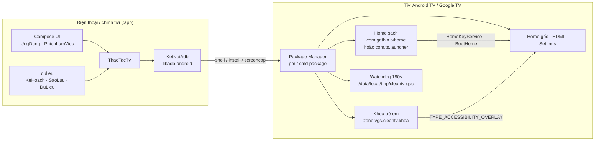
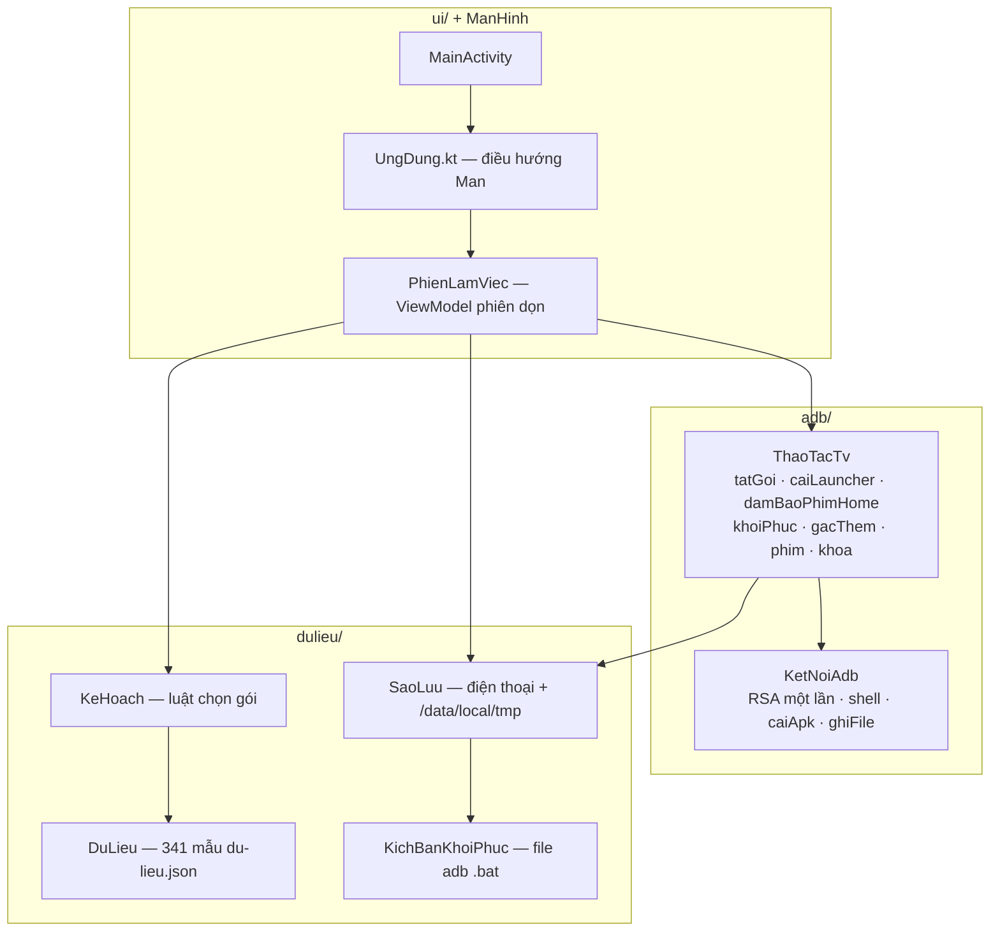
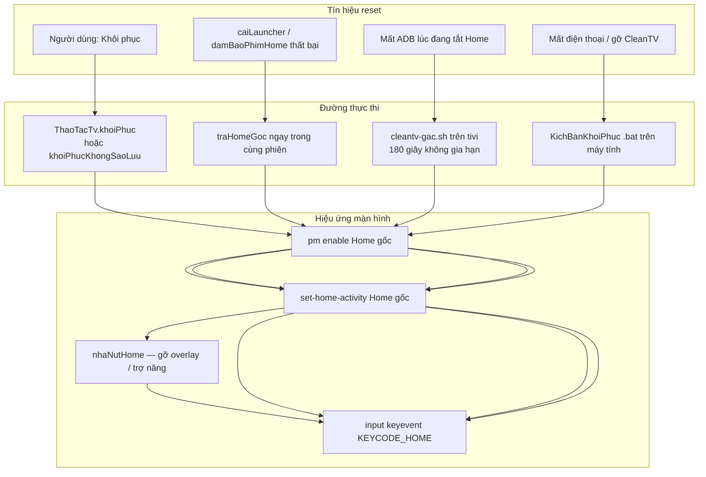
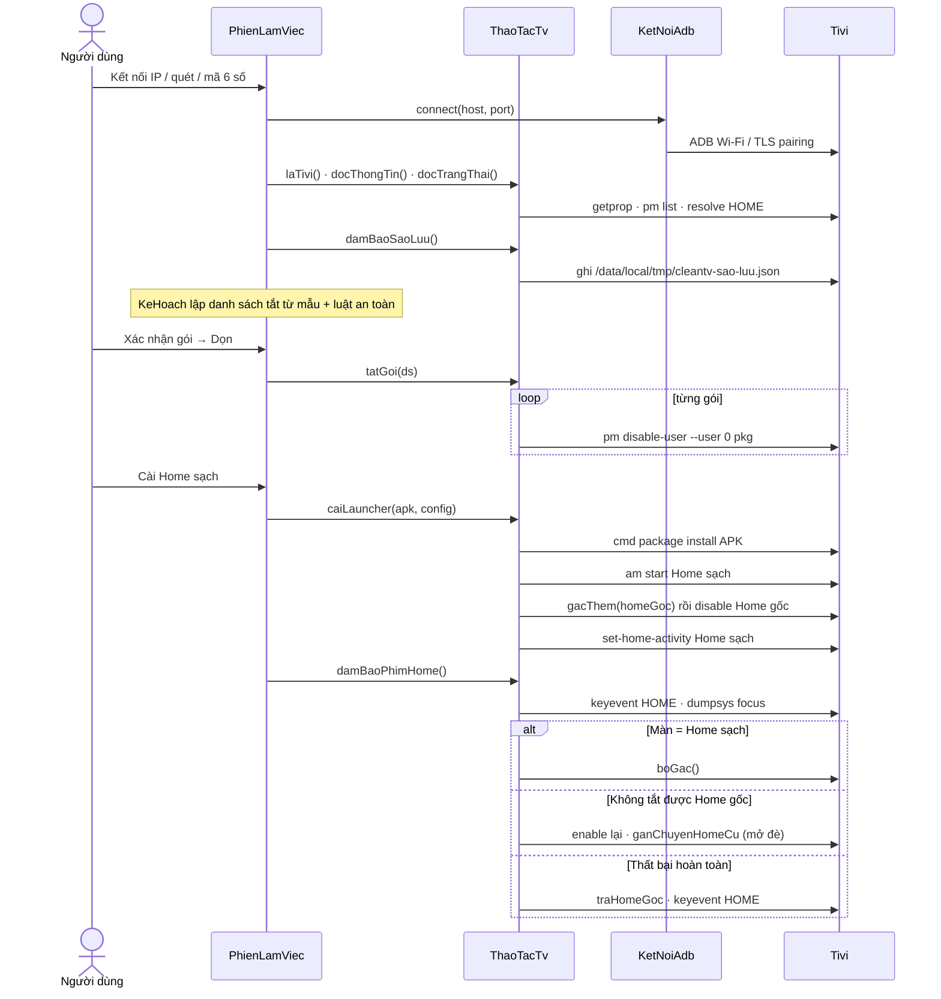
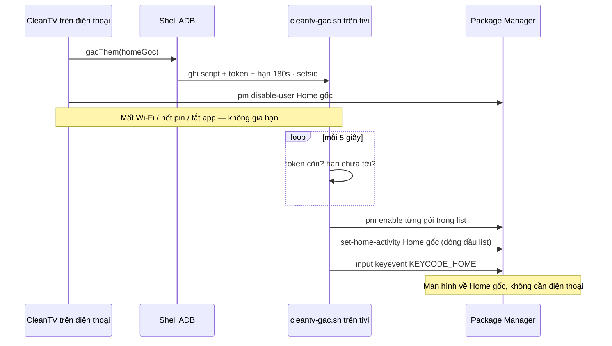
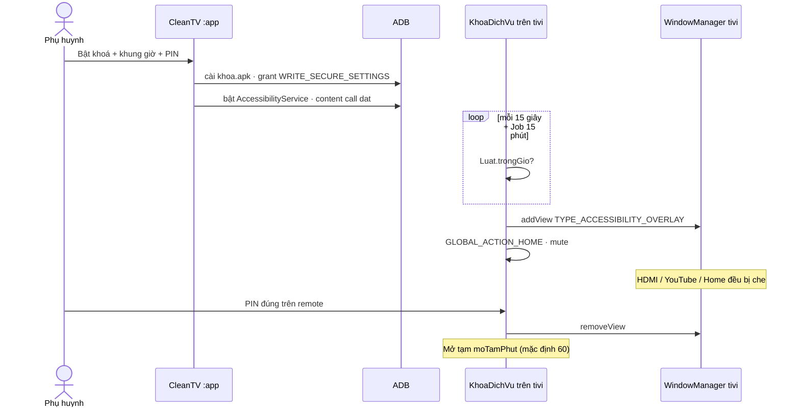
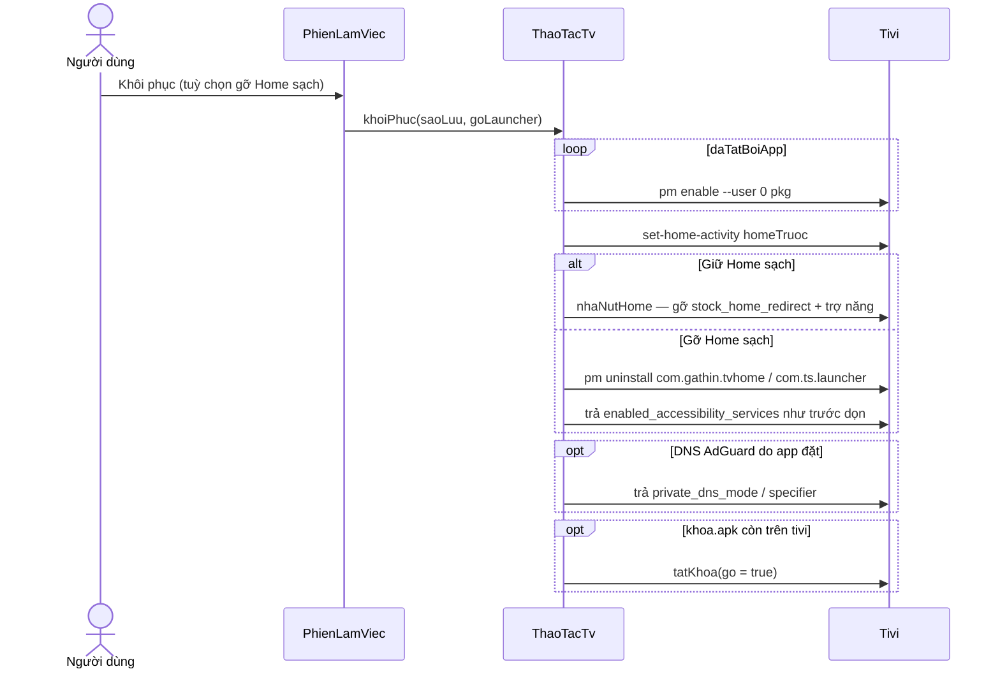
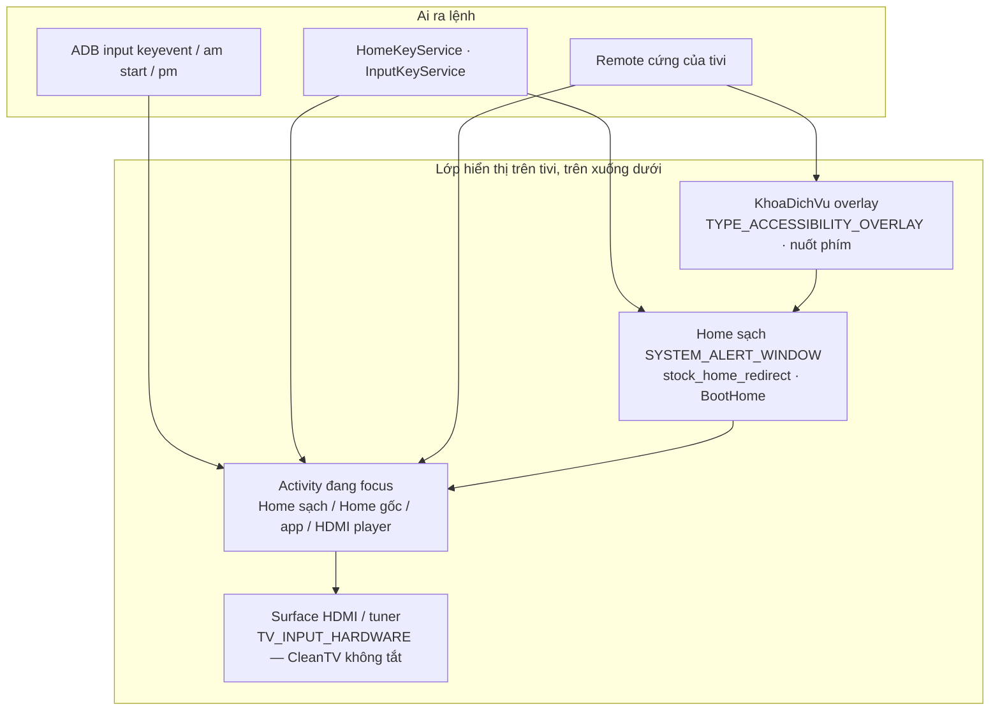

# CleanTV — Kiến trúc hệ thống

> Loại tài liệu: ARCHITECTURE (HLD + sơ đồ khối + sequence).
> Mã đã đọc: `ThaoTacTv.kt`, `KetNoiAdb.kt`, `PhienLamViec.kt`, `KeHoach.kt`, `KhoaDichVu.kt`, `KhoiDong.kt`, `KichBanKhoiPhuc.kt`.
> Cập nhật: 2026-10-30

## 1) Mục tiêu

CleanTV dọn quảng cáo / theo dõi / app rác trên Android TV và Google TV **qua ADB Wi-Fi**, rồi **thay màn Home** bằng launcher sạch. Không root. Chỉ **tắt gói** (`pm disable-user`), không gỡ phần mềm hệ thống. Mọi thay đổi có sao lưu và đường khôi phục.

Hai câu hỏi kiến trúc:

1. Hệ thống được ghép thế nào (HLD + sơ đồ khối)?
2. Cơ chế nào **điều khiển** hoặc **thiết lập lại** màn hình tivi?

## 2) High-level design

Ba tiến trình độc lập, không `implementation(project(":khoa"))`. Kênh duy nhất từ điện thoại sang tivi là **ADB shell**.

### Hợp đồng cốt lõi

| Quyết định | Hiện trạng |
|---|---|
| Mặt phẳng điều khiển | ADB Wi-Fi (cổng 5555 hoặc ghép mã 6 số TLS). App chạy trên tivi thì nối `127.0.0.1:5555`. |
| Thay đổi gói | `pm disable-user --user 0`, không `pm uninstall` gói hệ thống. |
| Home sạch | APK nằm `assets/` (dựng từ CleanYourTV + `patches/launcher-vgs.patch`). Không có source launcher trong `:app`. |
| Khoá trẻ em | APK module `:khoa`, cài lên tivi qua ADB, cấu hình qua ContentProvider. |
| An toàn Home | Trước khi tắt Home: watchdog 180 giây chạy **trên tivi**. Thất bại → bật lại mọi gói vừa tắt. |

### Module Gradle

| Module | `applicationId` | Namespace | Vai trò |
|---|---|---|---|
| `:app` | `zone.vgs.cleantv` | `zone.vgs.tvsach` | App điều khiển (điện thoại hoặc trên tivi) |
| `:khoa` | `zone.vgs.cleantv.khoa` | `zone.vgs.khoa` | Overlay khoá PIN / mode trẻ em, cài lên tivi |

Launcher Home sạch **không** là module Gradle. Script `scripts/dung-launcher.sh` vá và nhét APK vào assets.

## 3) Sơ đồ khối — lớp phần mềm `:app`

Luồng màn hình phiên dọn (`Man` trong `PhienLamViec.kt`):

`CHINH → KET_NOI → THONG_TIN → CHON_GOI → DANG_TAT → HOME_SACH → XONG`

Nhánh phụ: `KHOI_PHUC`, `KHOA_TRE` / `MODE_TRE`, `REMOTE`.

## 4) Cơ chế điều khiển hoặc thiết lập lại màn hình TV

Màn hình tivi không bị vẽ từ điện thoại. App **thay đổi ai được phép hiện trên tivi**, rồi **bấm phím Home thật** để hệ thống vẽ lại. Có bảy cơ chế, xếp theo mức đụng vào pixel.

### 4.1 Bảng cơ chế

| # | Cơ chế | Chiều | Lệnh / API | Khi nào |
|---|---|---|---|---|
| A | Đặt Home mặc định | Điều khiển | `cmd package set-home-activity` + `input keyevent KEYCODE_HOME` | Cài Home sạch, khôi phục, watchdog |
| B | Tắt / bật launcher | Điều khiển + reset | `pm disable-user` / `pm enable` | Thay Home, rollback, khôi phục |
| C | Mở đè Home cũ | Điều khiển | `HomeKeyService` + `stock_home_redirect` + `SYSTEM_ALERT_WINDOW` | Google TV còn setupwraith, TCL, hộp nhà mạng, hãng tự bật lại Home gốc |
| D | Phím ảo ADB | Điều khiển | `input keyevent <KEYCODE>` | Remote điện thoại, thử nút Home, hẹn ngủ (223), watchdog |
| E | Mở activity / app | Điều khiển | `am start -n`, `monkey -p … LEANBACK_LAUNCHER` | Mở thử Home sạch, HDMI máy chiếu, mở app từ remote |
| F | Overlay trợ năng | Điều khiển | `TYPE_ACCESSIBILITY_OVERLAY` + nuốt `onKeyEvent` | Khoá trẻ em (che cả HDMI), bài toán YouTube |
| G | Watchdog / khôi phục | **Thiết lập lại** | Script `cleantv-gac.sh`, `khoiPhuc`, kịch bản `.bat` | Mất kết nối lúc đổi Home, người dùng bấm Khôi phục, mất điện thoại |

### 4.2 A — Đặt Home mặc định (đường chính)

Android chọn activity `MAIN` + `HOME` khi bấm nút Home. CleanTV:

1. Cài APK Home sạch (`com.gathin.tvhome`, Xiaomi nội địa: `com.ts.launcher`).
2. Mở thử `am start -W -n <cmpHome>` — thất bại thì **không** tắt Home gốc.
3. `pm disable-user` Home gốc (trừ CVTE, hang lạ chưa thắng, setupwraith còn bật).
4. `cmd package set-home-activity --user 0 <cmpHome>`.
5. `input keyevent KEYCODE_HOME` rồi đọc `dumpsys window` / `dumpsys activity` (`goiDangHien`) để xác nhận màn đang hiện.

Điểm tham chiếu: `ThaoTacTv.caiLauncher`, `ThaoTacTv.damBaoPhimHome`.

### 4.3 B — Tắt gói (đổi nội dung màn, không vẽ trực tiếp)

`tatGoi` lọc nhiều lớp rồi mới `pm disable-user`:

- Gói lõi Android / MediaTek (`KeHoach.laGoiLoiAndroid`) — không tắt; nếu đã tắt từ trước thì `batLaiGoiLoi`.
- Home đang dùng khi chưa có Home khác.
- Gói `TV_INPUT_HARDWARE` (HDMI/AV/ăng-ten).
- App mở HDMI (`VIEW vnd.android.cursor.item/channel`) hoặc Cài đặt.
- `setupwraith` nếu nó đang giữ Wi-Fi đã lưu.

Tắt gói quảng cáo **không** đổi Home; chỉ làm màn Home gốc / app rác hết hiện.

### 4.4 C — Mở đè khi không tắt được Home gốc

Khi `pm disable-user` bị hãng từ chối hoặc tự bật lại:

1. Bật lại mọi gói vừa tắt (không để tivi không Home).
2. Ghi `stock_home_redirect` vào `config.json` của launcher.
3. Cấp `WRITE_SECURE_SETTINGS` + `SYSTEM_ALERT_WINDOW`.
4. Bật `HomeKeyService` (accessibility).
5. Mở Cài đặt rồi bấm Home — dịch vụ thấy Home cũ thì mở Home sạch đè lên.
6. `BootHome` (bản vá launcher): rút điện bật lại vẫn tự mở đè.

Không dùng trên **bo mạch CVTE** (đã có tivi treo màn khởi động sau khi tắt Home gốc).

Điểm tham chiếu: `ThaoTacTv.chuyenDe` / `ganChuyenHomeCu`.

### 4.5 D — Phím ảo và remote điện thoại

`ThaoTacTv.phim(ma)` → `input keyevent $ma`. Remote trên điện thoại gửi D-pad, OK, Home, Back, volume, nguồn. Gõ chữ: broadcast `TYPE_TEXT` qua `HomeKeyService` (có dấu); không có dịch vụ thì `input text` (không dấu).

Hẹn tắt tivi: tiến trình `setsid` trên tivi, hết giờ `input keyevent 223` (KEYCODE_SLEEP). Đóng app điện thoại vẫn chạy.

### 4.6 E — Overlay khoá trẻ em (che pixel)

`:khoa` là AccessibilityService trên **tivi**:

- Trong khung giờ: lớp `TYPE_ACCESSIBILITY_OVERLAY` full-screen, `GLOBAL_ACTION_HOME` để app đang chạy lui nền, tắt tiếng.
- Nuốt **mọi** phím remote (kể cả HDMI, volume, Home). Chỉ còn lưới PIN.
- Job `CanhGac` 15 phút: nếu phụ huynh tắt dịch vụ trong Cài đặt thì bật lại (`WRITE_SECURE_SETTINGS` do CleanTV cấp qua ADB).
- Mode trẻ em: overlay bài cộng trừ khi YouTube ở trước quá số phút.

Đây là cơ chế **duy nhất** vẽ đè lên cả nguồn HDMI mà không đổi Home.

### 4.7 G — Thiết lập lại màn hình (reset)

Bốn đường, cùng mô hình: **bật lại gói → đặt Home gốc → bấm Home**.

Watchdog (`KICH_BAN_GAC`, `GAC_GIAY = 180`):

1. Trước `pm disable-user` một Home: `gacThem(pkg)` ghi script + danh sách gói lên `/data/local/tmp/cleantv-gac*`, `setsid sh` trên tivi.
2. Điện thoại `giaHanGac()` mỗi vòng thử nút Home.
3. Việc xong: `boGac()` xoá token.
4. Hết hạn / mất token hợp lệ: tivi `pm enable` mọi gói trong list, `set-home-activity` gói đầu (Home gốc), `KEYCODE_HOME`.

Kịch bản sống qua lúc phiên ADB đóng — đây là lớp cứu màn đen khi Wi-Fi rớt lúc đang thay Home.

## 5) Sequence — phiên dọn đầy đủ

## 6) Sequence — watchdog tự trả Home gốc

## 7) Sequence — khoá trẻ em che màn hình

## 8) Sequence — khôi phục có sao lưu

Không có sao lưu trên điện thoại: đọc bản trên tivi, hoặc `khoiPhucKhongSaoLuu` (mọi gói `enabled=3`, Home hệ thống đầu tiên app biết). Máy tính: `KichBanKhoiPhuc.tao` → file lệnh adb thuần.

## 9) Sơ đồ khối — ai được vẽ lên màn hình

Thứ tự ưu tiên thực tế:

1. Overlay khoá trẻ em (nếu đang trong giờ) — chặn hết.
2. Home sạch mở đè nếu `stock_home_redirect` khớp gói đang hiện.
3. Activity Home mặc định (sau `set-home-activity`).
4. App / nguồn HDMI phía dưới.

## 10) Chiến lược Home theo loại tivi

| Loại tivi | Tắt Home gốc? | Màn sau nút Home | Ghi chú |
|---|---|---|---|
| Android TV Home gốc app biết (`tvlauncher`, `launcherx`, `leanbacklauncher`, `com.mitv.tvhome`) | Có, sau khi Home sạch mở được | Home sạch | Watchdog 180s trong lúc tắt |
| Google TV còn `setupwraith` giữ Wi-Fi | Không | Home sạch **mở đè** | Tắt setupwraith sẽ xoá mạng |
| TCL / hộp nhà mạng / hãng tự bật lại launcher | Thử tắt; thất bại thì đè | Home sạch đè lên Home cũ | `damBaoPhimHome` tối đa 4 vòng |
| Bo mạch CVTE (`com.cvte.*`) | Không bao giờ | Home gốc; Home sạch trong danh sách app | Tránh treo màn khởi động |
| Xiaomi nội địa | Có, bằng APK `com.ts.launcher` | Home sạch tên hãng cho phép | `com.gathin.tvhome` → màn đen |
| Fire TV / Android &lt; 8 | Không thay Home | Không đổi | Chỉ dọn gói |
| Launcher cài thêm (Dangbei, Projectivy…) | Giữ bật; tắt nếu tranh nút Home | Home sạch làm mặc định | Ghi vào sao lưu |

## 11) Ràng buộc bất biến

- Không `pm uninstall` gói hệ thống. Không tắt HDMI (`TV_INPUT_HARDWARE`), remote, bàn phím, CH Play, gói giữ Wi-Fi, gói lõi, Home đang dùng khi chưa có Home khác.
- Google Home / cast và tìm kiếm giọng nói **không** tích sẵn (`KeHoach` loại `GOOGLE_HOME`, `GIONG_NOI`).
- Thất bại khi đổi Home → tivi phải như trước (`traHomeGoc`, bật lại `gianh`).
- Sao lưu ghi hai nơi: điện thoại (`KhoSaoLuu`) và `/data/local/tmp/cleantv-sao-luu.json`.
- `applicationId` `zone.vgs.cleantv` khác package `zone.vgs.tvsach` — không đổi cho khớp.

## 12) Tham chiếu

| Chủ đề | Điểm vào |
|---|---|
| Shell ADB, chụp màn, cài APK | `app/.../adb/KetNoiAdb.kt` |
| Mọi thao tác tivi | `app/.../adb/ThaoTacTv.kt` |
| Phiên UI / remote / cài Home | `app/.../ui/PhienLamViec.kt` |
| Luật gói | `app/.../dulieu/KeHoach.kt` |
| Watchdog | `ThaoTacTv.KICH_BAN_GAC`, `GAC_GIAY` |
| Overlay khoá | `khoa/.../KhoaDichVu.kt` · `KhoiDong.kt` |
| Kịch bản máy tính | `app/.../dulieu/KichBanKhoiPhuc.kt` |
| Home sạch (upstream) | `patches/launcher-vgs.patch`, `scripts/dung-launcher.sh` |
| Chạy trên tivi | `ManHinh.laTv` → ADB `127.0.0.1` |
